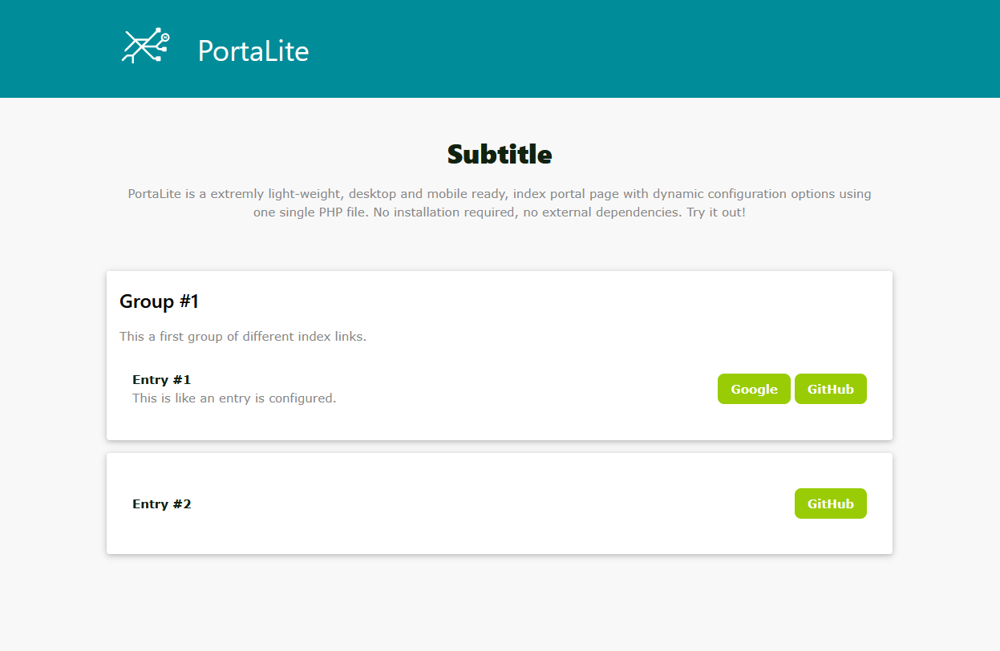

# PortaLite
PortaLite is a extremly light-weight, desktop and mobile ready, index portal page with dynamic configuration options using one single PHP file. No installation required, no external dependencies. Try it out!

## Usage
Simply clone this repository to your document root destination server with the following command:

```bash
git clone https://github.com/sebastianknopf/portalite.git
```

Then, copy `config.default.php` to `config.php` and modify the configuration to your needs.

Set the Apache's document root to `/path/to/your/repo/public`. Note the trailing `/public` which makes the other non-public files located in another directory, away from the public directory.

- Basic settings like title, subtitle, description, robots-meta and color scheme can be changed in the `index` key at toplevel.
- The whole content is divided into **Groups**. Each group then contains **Entries** and each entry contains one or more **Links**. 
- On groups, title and description are optional. On entries, the title is mandatory, the description is optional. On a link, you have to define the title and the url, target (default: `_self`) is optional.
- The footer can have optional `left`, `middle`, and `right` groups, each with a title and links. An optional `low` group contains only links; it appears inline on larger screens and floats above the bottom edge on mobile.

With a correctly configured `Apache` or `nginx`, you should see this view with basic configuration:



Feel free to use, to modify and to open an issue, if you have any question or want to contribute a little feature. The only regularity is: Keep it simple!

## License
This project is licensed under the Apache License. See [LICENSE](LICENSE.md) for more information.